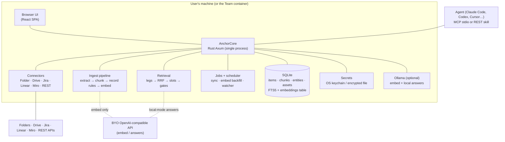
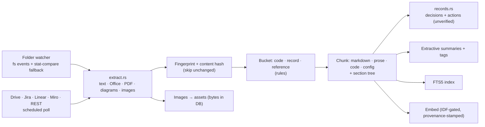

# AnchorCore — Architecture Overview

> Stack: **Rust (Axum) · React (Vite) · SQLite (FTS5 + embedding scan)** · embeddings via Ollama or any
> OpenAI-compatible API · answers written by your agent (`agent` mode) or by Ollama / a BYO cloud model
> (`local` mode). One binary serves the API and the embedded UI — locally and in the one-container Team
> image (`hosting/`). Retrieval knobs live in [guides/retrieval-tuning.md](./guides/retrieval-tuning.md);
> TOC mechanics in [guides/hierarchical-toc.md](./guides/hierarchical-toc.md).

---

## 1. Runtime model

One local process is the whole product: no Docker, no required sidecars. **Local:** the `anchorcore`
binary (`frontend/dist` embedded, SQLite + FTS5, data in `~/.anchorcore`). **Team self-hosted:** the same
binary in one container (`/data` volume, license-gated). A future Hosted tier would swap SQLite for
Postgres (B49, `hosted-cloud-plan.md`).

**Ingest uses no chat model** (R45.18): decisions and actions are read from record structure by rules.
The only model on the ingest path is the embedder, and it is optional — without it everything stays
keyword-searchable.

## 2. System diagram



## 3. Ingestion



- **Formats** live in `extract.rs` only — plain text, Word/PowerPoint/Excel/ODF/RTF/EML/PDF/HTML, diagram
  files (draw.io, Excalidraw, SVG, Visio) rendered to markdown via `diagram.rs`. Unreadable files are
  reported `skipped`, never purged.
- **Incremental sync:** folder files are re-extracted only when mtime/size change and re-processed only
  when the content hash changes. API connectors use cursors/stamps where available.
- **Chunking** (`chunking.rs`, `markdown.rs`, `config_chunks.rs`): markdown by fence-aware blocks with line
  ranges; code by symbols; config (YAML/JSON/TOML) by rule-level sections — a top-level key, or one entry of
  a top-level list of mappings, with identifying scalars (`settle_code`, `item_type`, `*_id`…) promoted into
  the breadcrumb and keys grouped into 500–800-char chunks; prose by headings + paragraph packing. Every
  chunk carries a section breadcrumb (`path`) used in its embedding input. Each item records the chunker
  generation that wrote its chunks (`chunker_version`); boot re-chunks older generations from stored text.
- **Records** (`records.rs`): `Decision:` headings/fields, `Status:`, `Owner:`, ADR front matter,
  `Action items` bullets and checkboxes become entities with record fields (status, due, supersedes…).
  Never prose sentences. Everything starts `unverified`; only a person verifies.
- **Embeddings** (`embedder.rs`): low-signal chunks skip the vector (IDF gate) and stay keyword-findable;
  every vector is stamped with its `provider:model:dim` family and only compared within it. A scheduler
  backfill (startup + every 15 min) drains missing vectors.
- **Images** (`assets.rs`): image bytes are stored in the DB (export/backup is self-contained), attached
  to the chunk that hosts them; images with no context go to the people-captioned "Unplaced images" view.
- **Deletion:** removing a source cascades to its items, chunks, entities and jobs (`foreign_keys=ON`).
- **Jobs and stopping them** (`jobs.rs`): at most 2 jobs run at once, the rest queue as `pending`; one
  sync/reclassify per source. Every active job has its own labeled Stop control (`Stop reclassify #11`)
  in its source row and in the System tab job list (the header "N running" badge opens it);
  `POST /sources/jobs/{id}/cancel` does the same for agents. A queued job cancels at once. A running job
  stops at its next checkpoint (between documents, classify windows and finalize phases); an in-flight
  embed call is dropped (the built-in engine finishes its current 64-text group), so Stop lands within
  about one provider call; measured 24–98 ms on a 500-file corpus with local Ollama. Cancelling again,
  or cancelling a finished job, is 409. The freed slot promotes the next queued job right away.
  **Partial ingestion is kept:** documents finished before the Stop stay searchable, and the job keeps
  its `processed/total` count (`cancelled — X/Y docs kept`). The interrupted document is not marked
  processed, so the next sync redoes only it and the files after it.

## 4. Q&A and search

```mermaid
sequenceDiagram
    participant C as UI / agent
    participant A as AnchorCore
    participant E as Embedder
    participant M as Answer model (local mode only)

    C->>A: question (+ history, project scope)
    A->>A: scope → source ids; label gate
    A->>A: follow-up rewrite (local mode, pronoun-only)
    A->>E: embed query (if an embedder is configured)
    A->>A: TOC-or-flat legs (vector scan + FTS5) → RRF
    A->>A: age decay · per-file cap · live-first · authority tiers
    A->>A: cut + type/keyword slots · filename boost · relevance gate
    alt agent mode
        A-->>C: cited evidence (mode: agent_compose) — the agent writes the answer
    else local mode
        A->>M: answer prompt with cited sections
        M-->>A: answer
        A-->>C: answer + citations
    end
```

- **Fusion** is reciprocal-rank: `score = Σ weight / (60 + rank)` — never raw scores. Reordering happens
  after fusion.
- **Local-mode chat calls** (answer, follow-up rewrite, acronym expansion, the settings ping) go through
  `llm_chat.rs`. A loopback Ollama (port 11434, or the `ollama_base_url` root) gets native `/api/chat`
  with `options.num_ctx` pinned to 8192 (`ANCHOR_OLLAMA_NUM_CTX` overrides); every other provider keeps
  `{base}/chat/completions` unchanged. Agent mode makes no chat call.
- **Status filter:** `status_ok` (`retrieval.rs`) is the single place stale/disputed rows are dropped, for
  every path including `/decisions` and `/actions`.
- **Hits** are leaf chunks with match-centred previews, leg provenance and RRF-range scores; summary chunks
  are TOC internals and never surface as evidence.
- **Ownership and supersession** are answered by `GET /actions` and `GET /decisions` (record fields), not
  by a retrieval leg.
- **Vocabulary:** a people-owned glossary (`/glossary`, marked glossary files, strict initialism rule)
  widens keyword queries. Nothing is proposed by a model.
- **Projects** scope every question to a bundle of sources.

## 5. Data model (main tables)

| Table | Holds |
|---|---|
| `sources` | connector, config (no secrets), label `internal\|public\|sensitive`, sync cursor |
| `ingested_items` | one row per document: text, content/processed hashes, stat fingerprint, bucket (`doc_type`), manual `is_pii` / `is_glossary` marks, `chunker_version` |
| `sections` | heading tree per item: parent, level, path, extractive summary, line range |
| `chunks` | `document` / `entity` / `caption` leaves + `section_summary` / `doc_summary`; path, line range, embedding + `embed_fp` |
| `chunks_fts`, `vec_chunks` | FTS5 index; plain embeddings table (no `sqlite-vec` linked — retrieval scans) |
| `entities` | decisions / actions / notes with record fields, owner, status `unverified\|verified\|disputed\|stale` |
| `relationships`, `disputes`, `merge_actions` | `conflicts_with` etc. links, dispute audit, duplicate merges |
| `tags`, `chunk_tags` | deterministic topic tags |
| `vocabulary` | glossary terms (`manual` · `glossary` · `rule`) |
| `assets`, `asset_blobs` | image metadata + content-addressed bytes |
| `projects`, `project_sources` | scoped-search bundles |
| `jobs`, `system_events`, `embed_state` | job queue/history, audit trail, query embedding family |
| `app_settings`, `users` | runtime setting overrides; Team auth users |

Migrations are in `rust/crates/anchorcore/migrations/` (registered in `db.rs`).

## 6. Security

- Binds `127.0.0.1` by default. LAN binds without auth are refused on bare metal; the Team container
  binds `0.0.0.0` behind a Host/Origin allowlist and `ANCHOR_AUTH_SECRET` logins.
- Secrets live in the OS keychain (per-key encrypted-file fallback), never in the DB, configs or logs;
  API responses mask them as `***set***`.
- **Labels:** `sensitive` sources never go to an untrusted cloud provider (embed or answer); the
  refusal is recorded in `system_events`. `/qa/public` and MCP `public_only` see `public` sources only.
- **PII** is a manual whole-document mark (R35.1); there is no auto-detection.
- `GET /media/:uid` serves image bytes from the DB only, label-gated and CSP-sandboxed.

## 7. Swap points

| Interface | Today | Later |
|---|---|---|
| Vector search | SQLite embedding scan | `sqlite-vec` (R43.10); pgvector for hosted |
| Embedder | Ollama · OpenAI-compatible | built-in local engine (R45.4) |
| Answers | agent (MCP/REST) · Ollama · OpenAI-compatible | MCP sampling (R45.2b) |
| Connectors | Folder · Drive · Jira · Linear · Miro · REST | demand-driven (FigJam, Lucid, Slack…) |
| Agent access | MCP stdio (`anchorcore mcp`) + REST skill — see [mcp.md](./mcp.md) | MCP HTTP transport (B14.2) |
| DB | SQLite (local + Team) | Postgres for hosted (B49) |

---

*Companion docs: [product-plan.md](./product-plan.md), [mcp.md](./mcp.md), [packaging.md](./packaging.md), [releasing.md](./releasing.md), [design-system.md](./design-system.md)*
