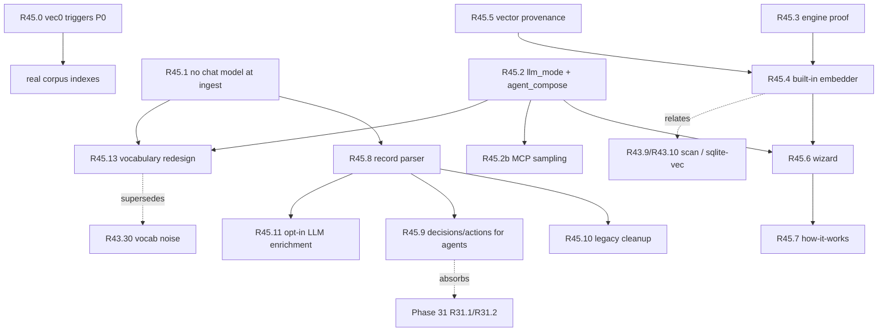

# Handover 2026-10-21: agentic vs local LLM, built-in embeddings, entities rework

For the next agent / owner. Base: `main` at `57fd81c` (v1.0.34), in sync with
`origin/main`. **No product code was changed.** This document is the plan,
the evidence behind it, and the order of work. It supersedes the draft
`docs/plan-setup-modes-and-models.md` (removed; everything is folded in here).
Proposed as **Phase 45** in `rust/BACKLOG.md`; rows are not filed yet.

Working tree note: `rust/BACKLOG.md` carries an uncommitted R43.30 row
(vocabulary proposal noise) from another session. It isn't part of this work,
but it interacts with it: see §6.

---

## 1. Summary

AnchorCore presents itself as "local LLM classifies and answers". The code
says otherwise:

- **Chunking and almost all classification are deterministic Rust.** The
  local chat model runs at ingest only for entity extraction and
  distillation, and retrieval deliberately ignores both outputs.
- **The model that matters is the embedding model** (`nomic-embed-text`). It
  is half of search. Today it needs Ollama.
- **Agents already write their own answers** (MCP `search`, or the
  `anchorcore-search` skill over REST), but MCP and REST `ask` still route
  through the server's answer model and warn "not composed" when there isn't
  one.

The rework:

1. **Two modes, one setting (`llm_mode`): agentic LLM vs local LLM**,
   applied to every surface (MCP, REST/skill, search, ask, UI).
2. **No chat model at ingest by default.** Extraction becomes deterministic
   and opt-in.
3. **Built-in embeddings**: nomic-embed-text v1.5 runs inside the Rust
   binary (candle). The weights are downloaded on first run, not compiled
   in. Ollama becomes optional everywhere.
4. **Entities rebuilt around the jobs chunks can't do**: decision log, action
   tracker, ownership, supersession. They're parsed from the structure records
   already carry, and exposed to agents.
5. **Vocabulary without proposals**: query-time expansion by the agent or
   local model, plus a people-owned glossary. The review queue goes away.
6. **Every part explains itself**: what runs, why, where, and what leaves
   the machine.
7. **First, unblock indexing**: Python-era `vec0` triggers break every
   chunk write on upgraded databases (the owner's `~/Documents` source has 2
   chunks).

---

## 2. Why: findings and evidence

All from reading the code at `57fd81c`, plus a copy of the owner's live
`~/.anchorcore/anchorcore.db` (read-only, in the session scratchpad).

### 2.1 Where language models are called today

| Call | Code | Output | Reaches search / agents? |
|---|---|---|---|
| Answer generation | `answer.rs` `generate_answer` | the composed answer | UI Ask, MCP `ask`, REST `/qa` |
| Follow-up rewrite | `answer.rs` `rewrite_followup` → `llm_rewrite` | standalone query | `ask` only |
| Entity extraction | `classifier.rs` `Classifier::classify`, per 16k window (`pipeline.rs` `ClassifyCtx::classify_windows`) | decision/action/note rows + `defined_terms` | **No.** Entity chunks are excluded from the leaf pool (`retrieval.rs` `KindScope::Leaf` = `kind IN ('document')`, R33.3). Only corroborated `defined_terms` expand keyword queries. |
| Distillation | `pipeline.rs` `distill_all` → `Classifier::distill` (`distill_enabled` defaults **true**) | `kind='distilled'` chunks | **No.** Excluded from the leaf pool. |
| Embeddings | `embedder.rs`, Ollama `/v1/embeddings` | 768-d vector per chunk and query | **Yes**: the vector leg of fusion + the cosine ≥ 0.50 evidence gate |

Deterministic already: chunking (`chunking.rs`, `markdown.rs`: headings,
symbols, config keys, tables, sentence-snapped windows), the bucket
(`classifier::assign_bucket`, regex over the 12k head), section summaries
(`extractive_section_summary`), tags (`tags::propose_tags`) and Tier-1
vocabulary (`vocab::extract_vocab_rules`).

### 2.2 Entities in practice (owner's DB)

| Fact | Value |
|---|---|
| Entities | 1,803. **1,762 (98%) are rule-generated** (`reasoning='rule-based classifier'`); 41 came from the LLM. |
| Marked `verified` | ~1,800, **automatically**: `pipeline.rs` sets `verified` when confidence ≥ 0.7, and the rules emit 0.72/0.78. No human reviewed them. |
| `owner` set | **0.** The pipeline inserts `''`. |
| `relationships` | 0. Only manual conflict-marking (`entities.rs`) or backup import creates them. |
| Quality (random sample) | real ("Billing migration — D0005: Stripe provider"), duplicated ("proceed with phased rollout" ×N), junk (a direct-debits code table labelled *decision*; payment-scheme field paths labelled *action* because "owner" matched) |
| Origin | 1,609 from the `business-scale` test corpus, 194 from the real `~/Documents` source (left over from an older sync) |

Dead code: `retrieval.rs` `who_knows_search`, `is_who_knows` and `graph_expand`
have no production callers, only their own tests. Root `AGENTS.md`
describes them as part of `ask()`.

The records already carry structure that a parser can read exactly:
`# Decision: … — D0005`, `**Status:** Confirmed`, `**Owner:** Maya`,
`## Action items` / `- [ ] Alex: draft spec — due 2024-06-23`.

### 2.3 Agents and the answer path

- MCP `ask` (`mcp.rs` `tool_ask`) → `POST /qa` → `ask()` → `generate_answer`
  with the configured answer model. With none, it returns `mode: context_only`
  plus "This is NOT a composed answer…" (R23.4). Correct, but it reads as
  broken when the agent *is* the answerer.
- The `anchorcore-search` skill (REST fallback for machines that block local
  MCP servers, e.g. managed work laptops) only calls `POST /qa/search`,
  `GET /items/:id`, `/outline` and `/nodes/:id`. That's already the
  agent-composes path, and it never touches a chat model.

### 2.4 Embeddings in practice (owner's DB)

- 247 of 441 chunks have no vector. They average 880 chars, so these aren't
  IDF-gate skips. The log shows `embedding backfill failed (… localhost:11434 …);
  247 chunks still pending` (2026-10-12): Ollama wasn't running. Semantic
  search can't see more than half the corpus.
- A hard dependency on a second running program is the weak point.

### 2.5 The indexing blocker

The live DB holds Python-era triggers `vec_chunks_ai/ad/au` on `chunks` plus
`vec_chunks*` shadow tables. `db.rs` `run_migrations` drops the triggers *for
the migration run* and then restores them, so every later chunk
insert, update or delete fails with `no such module: vec0` (this binary links
no sqlite-vec). Source 1 (`~/Documents`) shows that error and has 2 chunks.

---

## 3. Built-in embeddings: probe results

A standalone probe (session scratchpad, not in the repo; key code in §3.3)
loaded nomic-embed-text v1.5 with candle, with weights fetched at runtime.

### 3.1 Results (Apple M2 Pro)

| Check | Result |
|---|---|
| Engine | `candle-transformers` 0.11.0 ships `models::nomic_bert` (RoPE, SwiGLU, fused QKV) + `mean_pooling` + `l2_normalize`. Pure Rust. |
| Install-later | `nomic-ai/nomic-embed-text-v1.5` at pinned revision `e9b6763023c676ca8431644204f50c2b100d9aab`: `config.json`, `tokenizer.json` (0.7 MB), `model.safetensors` (546.9 MB, f32). 19 s download; mmap load 0.11 s. |
| Tokenizer | `tokenizers` 0.22, `default-features=false, features=["fancy-regex"]` (avoids the Oniguruma C build) |
| Binary | the entire probe (candle + tokenizers + reqwest) is a 10.6 MB release binary; the delta inside AnchorCore is smaller |
| **Parity vs Ollama `nomic-embed-text`** | **cosine 1.00000** on every text, document and query prefixes, CPU and Metal. Existing stored vectors stay valid, so switching needs no re-embed. |
| Sanity | "when do we switch payment providers?" → Stripe billing chunk 0.70, reconciliation 0.47, unrelated 0.42 |

| Backend | Ingest (64 × 765-char chunks) | One query |
|---|---|---|
| candle CPU, pure Rust | 9.5 chunks/s | — |
| candle CPU + `accelerate` (macOS BLAS) | 25–26 chunks/s | 50 ms |
| **candle `metal` (macOS GPU)** | **44 chunks/s** | **7.9 ms** |
| Ollama (Metal) | 67 chunks/s | 26.5 ms (incl. HTTP hop) |

Reading the numbers:
- Built-in is about **3× faster per search** than Ollama, because there's no
  cross-process HTTP.
- Ollama is about **1.5× faster at bulk ingest** on a Mac: ~4 min vs ~2.5 min
  for a 10k-chunk first index. That's a one-off background cost; incremental
  syncs are small.
- **Windows/Linux CPU is the open risk.** The pure-Rust path ran at 9.5/s here,
  and Ollama's CPU path (llama.cpp) is heavily optimised. Measure before
  deciding the per-OS default.

### 3.2 Not proven yet (R45.3)

1. Windows MinGW + Linux CI builds. Everything is pure Rust except Metal and
   Accelerate (macOS only), so it should build, but MinGW has broken native
   dependencies before.
2. Windows/Linux CPU throughput, plus the `mkl` option on x86.
3. f16 storage (halves disk to ~274 MB, same as Ollama's GGUF): candle CPU
   f16 speed and parity are unmeasured. HF ships f32 safetensors only.
   An int8 ONNX (137 MB) exists but would need an ONNX engine.
4. The golden eval with real vectors, and parity over a full corpus rather
   than 4 texts.

### 3.3 Probe core (for reproduction)

```rust
// deps: candle-core/candle-nn/candle-transformers 0.11 (+ "accelerate","metal" on macOS),
//       tokenizers 0.22 { default-features=false, features=["fancy-regex"] }
let device = Device::new_metal(0)?;               // or Device::Cpu
let cfg: Config = serde_json::from_slice(&std::fs::read(dir.join("config.json"))?)?;
let mut tok = Tokenizer::from_file(dir.join("tokenizer.json"))?;
tok.with_padding(Some(PaddingParams::default()));
let vb = unsafe { VarBuilder::from_mmaped_safetensors(&[dir.join("model.safetensors")], DType::F32, &device)? };
let model = NomicBertModel::load(vb, &cfg)?;
// per batch: ids/mask tensors from tok.encode_batch(texts, true), stacked
let hidden = model.forward(&ids, None, Some(&mask))?;
let vecs = l2_normalize(&mean_pooling(&hidden, &mask)?)?.to_vec2::<f32>()?;
// inputs keep the R43.6 prefixes: "search_document: " / "search_query: "
```

---

## 4. Target design

### 4.1 Agentic LLM vs local LLM

One setting, `llm_mode`:

- **`agent` (agentic LLM).** An agent writes the answers. AnchorCore runs no
  chat model. Two equal channels, and agentic mode must never assume MCP:
  - **MCP**: `anchorcore mcp` (Claude Code, Codex, opencode, Cursor, Claude
    Desktop…).
  - **REST via skill**: `anchorcore-search` over the local HTTP API, for
    machines where local MCP servers aren't allowed.
- **`local` (local LLM).** AnchorCore writes answers with its configured
  model: Ollama by default, picked by RAM. A BYO OpenAI-compatible endpoint
  stays as an *advanced* setting on the same path (`answer_base_url`); it
  isn't a third mode.

Embeddings are required in both modes and are built in. Ollama is needed
only for a local answer model, or optionally for faster ingest.

| Surface | `agent` | `local` |
|---|---|---|
| MCP `search`, REST `POST /qa/search` (the skill's main call) | unchanged: fused, gated, verbatim chunks | unchanged |
| REST `GET /items/:id`, `/outline`, `/nodes/:id` | unchanged | unchanged |
| MCP `ask`, REST `POST /qa`, `/qa/public` | scope + label/PII gate + `public_only` + fusion. **No `llm_rewrite`, no `generate_answer`.** Returns `mode: agent_compose`: citations with content (capped as `include_content`), a one-line "compose from these" instruction, **no warning** | as today: `composed` |
| UI Ask tab | evidence view (ranked, cited passages) + "ask your agent, or switch to local for in-app answers"; not an amber degraded banner | as today |
| Ingest | no chat model | no chat model by default; `extract_entities=llm` is opt-in |
| Embeddings | built-in | built-in (Ollama optional) |

`mode` values:
- `composed`: the local LLM wrote it.
- `agent_compose`: the agent writes it, by design.
- `context_only`: local mode, but the model is unreachable (still warns).
- `none`: nothing matched, or everything was gated.

Switching modes is one setting and needs no re-ingest, because the data is
identical in both modes.

### 4.2 Built-in embeddings

- `embed_provider` = `builtin` (default) | `ollama` | `cloud` (OpenAI-compatible,
  off by default, blocked for sensitive/PII sources by the existing label gate).
- Weights **are not compiled in** (that would add 274–547 MB to every download
  and update). Download behaviour:
  - fetched on first run into `{data_dir}/models/nomic-embed-text-v1.5/`
    from the pinned HF revision
  - SHA-256 verified, resumable (`.part` + Range), with progress in the UI
  - an offline path for air-gapped machines: drop the files in the folder
- Per-OS Cargo features: `metal` + `accelerate` under
  `[target.'cfg(target_os = "macos")'.dependencies]`; pure CPU elsewhere
  (`mkl` only if R45.3 shows it's needed and it builds on MinGW).
- Team image (`hosting/Dockerfile`): pre-download the weights at build time.
  Remember the "compile-time includes outside `rust/`" gotcha does **not**
  apply, since nothing is `include_bytes!`'d.
- Vector provenance (R45.5): store `provider:model:dim`. On mismatch, queue a
  re-embed job and serve keyword-only for not-yet-re-embedded chunks; never
  compare mixed vectors. Parity means builtin ↔ Ollama nomic share a
  fingerprint family; record that explicitly rather than inferring it.
- Later: Matryoshka 256/512-dim storage (nomic v1.5) to cut full-scan cost
  until sqlite-vec lands (R43.9/R43.10). Measure recall first.

### 4.3 Entities: only where chunks can't do the job

| Use | Why RAG chunks can't | Today |
|---|---|---|
| **Decision log**: "what did we decide about billing, and is it current?" | needs one row per decision with ID, status, date, supersession | extracted, noisy, no supersession |
| **Action tracker**: "open actions for Alex", "what's overdue?" | filters on owner, due date and done | sentences only, no fields |
| **Ownership**: "who owns reconciliation?" | needs an `owner` field | column never written; `who_knows` never called |
| **Supersession / conflicts**: "D0012 overrides D0005" | relationship between records | manual only |

Dropped:
- `note` paraphrases of reference docs. They duplicate chunks.
- Distilled Q&A units. Retrieval excludes them.

Pipeline:
1. A **deterministic record parser** (`record` bucket only) reads
   - `# Decision: <title> — D0005`, `**Decision:**`, `**Status:**`
     (Confirmed/Accepted/Superseded)
   - `**Owner:**`, `**Date:**`, `Attendees:`
   - `## Action items` + `- [ ] Name: task — due YYYY-MM-DD` (the checkbox gives done/open)
   - ADR front-matter (`status:`, `supersedes:`, `deciders:`)

   It never reads table rows, code blocks or reference docs, and it dedupes by
   ID or normalized title per source.
2. New rows are **`proposed`**. **Remove the confidence ≥ 0.7 → `verified`
   auto-promotion**: `verified` means a person confirmed it.
3. Agents reach them through MCP `decisions` / `actions` tools **and** REST
   equivalents documented in the skill. The REST channel is first-class (§4.1).
4. LLM enrichment is opt-in (`extract_entities=llm`): only for records with no
   parseable structure, output always `proposed`, and the prompt must fill
   `owner`.

### 4.4 Vocabulary: replace "proposals + review queue" (supersedes R43.30)

**Why:** owner feedback, 2026-10-21: "these proposals are a nightmare, we
have to find a different way". The owner's DB shows the problem is the model
of the feature, not one regex:

| Origin | Rows | Quality |
|---|---|---|
| `llm`, `proposed` | 12 | **mostly right** (`ach → automated clearing house`, `ca → direct debit`), yet they sit in a human queue |
| `rule`, `active` | 50 | live in query expansion **with no review**. Some are right (`rfnd → refund`, `sla → service level agreement`); some are junk from payment-scheme code tables parsed as definitions: `psa → "card account issuer payment agent"` (×6), `cncl → update`, `p2p → payments`, `with → withdrawal` (inert only because `with` is a query stopword) |

Index-time guessing produces the junk, and the review queue hands the
cleanup to people. The fix is to stop guessing, not to guess better.

New design:
1. **Query-time expansion by the model that already exists.**
   - *Agentic mode:* the agent rewrites and broadens queries itself. The
     `anchorcore-search` skill already tells it to retry with synonyms, so
     AnchorCore does no vocabulary expansion.
   - *Local mode:* the answer model may expand acronyms in the query
     (`llm_rewrite` widened from pronouns-only, budgeted, cached per query).
     Nothing is stored.
2. **Explicit glossary, owned by people.** A user-editable term → expansion
   list in the UI, plus exact parsing of files the user marks as a glossary
   (CSV/Markdown table `term | expansion`). Glossary terms are trusted and
   active, with no proposals. Backup round-trips the glossary (vocabulary
   never round-tripped).
3. **Automatic extraction only where precision is near-certain**, with no queue:
   the `Full Phrase (FP)` parenthetical **with an initialism check** (letters
   match the phrase initials). Code-table rows are never auto-extracted; the
   user marks a code-table file as a glossary if they want it.
4. **Delete:**
   - Tier-2 LLM `defined_terms` (prompt suffix + parse)
   - the "Words to confirm" review queue
   - the corroboration/quarantine machinery (R40.7/R40.8)

   Migration: keep human-approved rows (they become glossary entries), drop
   `proposed`, and re-derive `rule` rows under the new initialism check.

The golden eval pins `dunning-01` (vocabulary recall). It must stay green via
the initialism rule or a fixture glossary. Record the R40.7 reversal in
`rust/docs/decisions.md`.

### 4.5 Every part explains itself

- **Wizard** (`OnboardingWizard.tsx`):
  1. "Who writes the answers?": *My AI agent* or *A local model on this
     computer*.
  2. Search model: the built-in download with progress and the copy below.
     Local mode can pick Ollama instead.
  3. Mode-specific step:
     - agent: "How does your agent reach AnchorCore?". Either **MCP**
       (`McpConnectCard`, moved up), or **Skill + local API**: install
       `anchorcore-search`, show base URL + auth, and run a live
       `/qa/search` probe.
     - local: Ollama check/start, then an answer-model picker sized by RAM
       (8 GB → 3B, 16 GB → 8B, 32 GB+ → larger) with download size shown.
       "Use my own API endpoint" sits behind Advanced.
  4. Connect a source.
  5. Try it: in agent mode, a copyable prompt to paste into the agent;
     otherwise ask here.
- **"How AnchorCore works"** card (System tab), plus `docs/how-it-works.md`
  and website copy:

| Stage | What | Why | Where | Leaves the machine? |
|---|---|---|---|---|
| Reading files | Text from PDF, Word, Markdown, code… | everything searchable as text | AnchorCore (Rust) | No |
| Splitting | Along headings, functions, config keys | answers cite the exact passage | AnchorCore (rules, no AI) | No |
| Search model | A 768-number "meaning fingerprint" per passage | "switch payment providers" finds "billing migration to Stripe" | built-in model, this machine | No |
| Keyword index | Full-text index | exact IDs, codes, errors | AnchorCore (SQLite) | No |
| Decisions & actions | Reads `Decision:`, `Owner:`, action lists | "what's still open for Alex?" | AnchorCore (rules) | No |
| Answers | Writes the reply from cited passages | readable answers with sources | agentic: your agent (MCP or skill); local: a model here | agentic: passages go to the agent's model; local: nothing (unless a BYO cloud endpoint) |

Wizard copy for the download (answers "why install anything if I use Claude?"):

> **One download: the search model (~300–550 MB).** AnchorCore finds
> passages by *meaning*, not just matching words. That needs a small model
> that turns text into numbers. It runs on this computer, and your documents
> never leave it. Your agent can't do this step: it writes answers, but it
> can't keep a searchable index of your files between sessions (Anthropic,
> for one, offers no embeddings API). Your agent still writes the answers.
> AnchorCore only finds the right passages for it.

---

## 5. Work items (Phase 45)

| ID | Title | Pri | Est | Deps | DoD (short) | Main files |
|---|---|---|---|---|---|---|
| **R45.0** | Drop Python-era `vec0` triggers permanently when the module isn't linked | **P0** | 0.5d | — | One-shot `M::up` migration; extend `migrate_pending_with_vec_triggers_and_no_vec0` so a chunk insert *after* migration succeeds; a Python-era DB re-syncs fully | `db.rs`, `migrations/` |
| **R45.1** | Ingest without a chat model: `extract_entities` (`off`/`rules`/`llm`), `distill_enabled` default false, readiness stops requiring the classifier model | P1 | 1d | — | Golden eval unchanged; `sample/` ingest makes zero chat calls (counting mock); before/after search diff recorded | `pipeline.rs`, `classifier.rs`, `ollama.rs` (`configured_local_models`), `settings.rs` |
| **R45.2** | `llm_mode` (`agent`/`local`) + `agent_compose` on every surface | P1 | 1.5d | — | Per-surface tests in both modes (MCP ask, `/qa`, `/qa/public`, `/qa/search` unchanged); zero chat calls in agent mode; `gated_provider` refusal still works; `answer_ready` true in agent mode; `/system/status` reports the mode | `answer.rs`, `mcp.rs`, `settings.rs`, `system.rs`, `frontend/src` Ask tab |
| R45.2b | MCP sampling when the client advertises it | P3 | 1.5d | R45.2 | Verify client support first; `agent_compose` stays the fallback | `mcp.rs` |
| **R45.3** | Finish the embedding-engine proof | P1 | 1d | — | MinGW + Linux CI builds; Win/Linux CPU throughput; f16 speed and parity; golden eval with real vectors; decision entry | probe → `rust/docs/decisions.md` |
| **R45.5** | Vector provenance + re-embed on model change | P1 | 1d | — | Fingerprint stored; mismatch queues re-embed; no mixed-vector comparison (test) | `embedder.rs`, `scheduler.rs`, migration |
| **R45.4** | Ship built-in embedder (`embed_provider`, download manager, per-OS features, Team image prefetch) | P1 | 2–3d | R45.3, R45.5 | Fresh machine with no Ollama → hybrid retrieval after the first-run download; checksum + resume tests; offline-drop path; Ollama provider still works; `/system/status.retrieval` shows the provider | `embedder.rs`, new `embed_local.rs`, `Cargo.toml`, `hosting/Dockerfile`, CI |
| **R45.6** | Wizard rework (mode-first, MCP-or-skill, RAM-sized local picker) | P1 | 2d | R45.2, R45.4 | Both modes and both agent channels walk end-to-end on a clean profile; `npm run build` + embedded rebuild | `OnboardingWizard.tsx`, `McpConnect.tsx`, `api.ts`, `types.ts` |
| **R45.7** | "How AnchorCore works" card + `docs/how-it-works.md` + website copy | P2 | 1d | R45.6 | Every stage lists what/why/where/what-leaves; copy reviewed by the owner | `frontend/src` System tab, `docs/`, `website/` |
| **R45.8** | Deterministic record parser; no auto-verify | P1 | 2d | R45.1 | `sample/` fixtures with exact expected rows (IDs, owners, due dates, done); zero rows from the direct-debits reference docs; new rows `proposed` | `classifier.rs` (or new `records.rs`), `pipeline.rs` |
| **R45.10** | Legacy entity cleanup migration | P2 | 0.5d | R45.8 | Per the owner's choice (§7.3); backup first; counts before/after recorded | migration |
| **R45.9** | `decisions` / `actions` for agents (MCP + REST + skill); wire `who_knows` to `owner` or delete it with `graph_expand`; absorb Phase 31 (R31.1/R31.2) | P2 | 2d | R45.8 | Agent can list open actions by owner over MCP **and** REST; no dead code left; Entities tab becomes Decisions + Actions views | `mcp.rs`, `entities.rs`, `retrieval.rs`, `.agents/skills/*`, Entities tab |
| R45.11 | Opt-in LLM enrichment for unstructured records | P3 | 1d | R45.8 | Only `extract_entities=llm`; always `proposed`; fills `owner` | `classifier.rs` |
| **R45.12** | Doc drift + skills update | P2 | 0.5d | lands with each row | See §8 | docs, skills |
| **R45.13** | Vocabulary redesign: glossary + query-time expansion; delete proposals, review queue, Tier-2 (supersedes R43.30) | P1 | 2d | R45.1, R45.2 | No vocabulary rows without a human or near-certain rule origin; junk from §4.4 gone; `dunning-01` green; glossary CRUD + glossary-file parse + backup round-trip; Review tab loses "Words to confirm" | `vocab.rs`, `classifier.rs`, `review.rs`, `retrieval.rs`, `answer.rs` (`llm_rewrite`), `backup.rs`, Entities/Review tabs, migration |

## 6. Dependency map



Waves (file-disjoint where parallel):

1. **R45.0** alone, first. The owner's corpus isn't indexing.
2. **R45.1 ∥ R45.2 ∥ R45.3 ∥ R45.5.** Serialize the `settings.rs` edits
   (R45.1/R45.2). After this wave, agentic mode needs no chat model;
   embeddings still need Ollama until wave 3.
3. **R45.4**, then **R45.6 → R45.7**. Ollama becomes optional; setup and
   copy reflect the final choices.
4. **R45.13** (vocabulary) after R45.1 and R45.2. It shares `classifier.rs`
   with R45.8 (both remove prompt pieces); serialize the two.
5. **R45.8 → R45.10 → R45.9 → R45.11** can run alongside waves 2–3
   (`classifier.rs`/`pipeline.rs` store path, `mcp.rs` tools, Entities tab).
   Don't overlap with R45.1 in `pipeline.rs`.

Cross-phase interactions:
- **R43.30 (vocabulary noise, uncommitted row):** superseded by R45.13. Its
  initialism check survives as point 3 of §4.4, but the queue-triage
  direction is dropped, because the queue itself goes away. Close R43.30 into
  R45.13 when folding the backlog.
- **Phase 31 (Entities clarity):** superseded by R45.9's Decisions + Actions
  views. Close R31.1/R31.2 into it with a note.
- **R43.9/R43.10 (scan/sqlite-vec):** independent. Matryoshka dims (§4.2)
  are a cheaper interim lever. R45.0 must not recreate `vec0` triggers;
  R43.10 owns any future `vec0`.
- **R43.7 (answer timeout/stream):** only applies in `local` mode after R45.2.

## 7. Decisions

### 7.1 Taken in this session (record in `rust/docs/decisions.md` when rows land)
- Two modes, not three: agentic LLM vs local LLM. A BYO cloud answer endpoint
  is an advanced variant of local, on the same code path.
- Agentic mode has two equal channels, MCP and REST-via-skill. No feature may
  be MCP-only.
- No chat model at ingest by default; extraction is deterministic first.
- Embeddings are built in via candle `nomic_bert`. Weights are downloaded,
  never compiled in. Ollama is optional.
- `verified` means human-confirmed; no automatic promotion.
- Vocabulary: no machine proposals and no review queue. Expansion is
  query-time (agent or local model) plus a human-owned glossary plus one
  near-certain rule. This reverses R40.7/R40.8.

### 7.2 Owner decisions still needed
1. **Embedding model / size budget**: nomic v1.5 (parity with stored vectors,
   547 MB f32 or ~274 MB f16 if R45.3 clears it) vs a smaller model like
   bge-small (384-d, a re-embed, weaker).
2. **Per-OS default if Windows/Linux CPU is slow**: built-in everywhere,
   suggesting Ollama for large corpora (proposed), or Ollama-default on
   non-Mac.
3. **Legacy entities (R45.10)**:
   - (a) demote rule-made `verified` → `proposed`
   - (b) delete rule rows from non-record items
   - (c) leave them for force re-sync

   Proposed: (a)+(b), with a backup first.
4. **UI Ask in agentic mode**: evidence-only (proposed), or allow a local
   model for in-app answers alongside the agent.
5. **Agentic data boundary**: passages an agent pulls via `search` go to the
   agent's model, and today only `ask` applies the label/PII gate. Should
   agentic mode treat the agent as an untrusted cloud provider (gate `search`
   too unless trusted), or as trusted because the user installed it?

## 8. Doc updates (land with the rows, same commit)

| Doc | Change | Row |
|---|---|---|
| root `AGENTS.md` | "What this is": Ollama optional, built-in embeddings, two modes. Retrieval section: remove the `who_knows` leg and `graph_expand` claims (or reword once R45.9 wires them). Architecture map: `embed_local.rs`. Gotchas: vec0-trigger rule, weights-not-compiled-in, vector provenance, `llm_mode`/`agent_compose` contract, "no feature MCP-only" | R45.0/.2/.4/.9/.12 |
| `rust/AGENTS.md` | vec0 bullet ("`rust` should use `sqlite-vec` statically linked") → current truth; lizard baseline if new functions land | R45.0/.12 |
| `rust/BACKLOG.md` | Phase 45 section + rows from §5; note on Phase 31 superseded; R43.30 cross-reference | on acceptance |
| `rust/docs/decisions.md` | entries per §7.1; engine choice with R45.3 numbers | R45.2/.3/.4/.8 |
| `docs/mcp.md` | `ask` modes (`agent_compose`), new `decisions`/`actions` tools | R45.2/.9 |
| root `AGENTS.md` "Corpus vocabulary is quarantined" gotcha | rewrite for glossary + query-time expansion; remove quarantine/corroboration rules | R45.13 |
| `docs/guides/retrieval-tuning.md` vocabulary section | same | R45.13 |
| `.agents/skills/anchorcore-search/SKILL.md` | `POST /qa` → `agent_compose` as the gated alternative; decisions/actions endpoints | R45.2/.9 |
| `.agents/skills/anchorcore-setup/SKILL.md` | read/set `llm_mode`, `embed_provider`, model download status; honesty contract gains `agent_compose` | R45.2/.4 |
| `docs/guides/retrieval-tuning.md` | embedding provider + provenance; Matryoshka knob if adopted | R45.4/.5 |
| `docs/how-it-works.md` (new) + website | §4.5 table and copy | R45.7 |
| `hosting/` README / `docs/releasing.md` | weights prefetch in the image; release checklist: model revision + checksum pinned | R45.4 |
| `docs/release-notes/` | user-facing: "no Ollama needed", modes, entities change | per release |

Skills are installed state (`skills-lock.json`); bump them with the release
that changes the API contract.

## 9. Gates (unchanged, apply to every row)

- `cargo test -p anchorcore` + `cargo check` (`-D warnings`) green. On a dev
  Mac use `ANCHOR_SECRETS_NO_KEYRING=1`.
- Golden eval `--test retrieval_eval` at 1.00 fused recall.
- Lizard: no new warnings over the baseline in `rust/AGENTS.md`.
- Frontend: `npm run build`, then rebuild the binary (UI is embedded).
- The suite must pass without Ollama **and** without downloaded weights
  (degraded keyword-only, hash embeddings in tests). Put real-model runs
  behind an opt-in env, like today's manual probes.
- New native-ish dependencies (candle `metal`/`accelerate`) are macOS-only
  target deps; prove MinGW + Linux CI before merging R45.4.

## 10. Resume here

1. Owner reviews §7.2 and accepts or edits Phase 45; fold §5 into
   `rust/BACKLOG.md`.
2. Start R45.0 (half a day, unblocks the owner's real corpus), then wave 2.
3. The probe lives only in the session scratchpad. Rebuild it from §3.3 for
   R45.3 (the weights download again, 547 MB).
